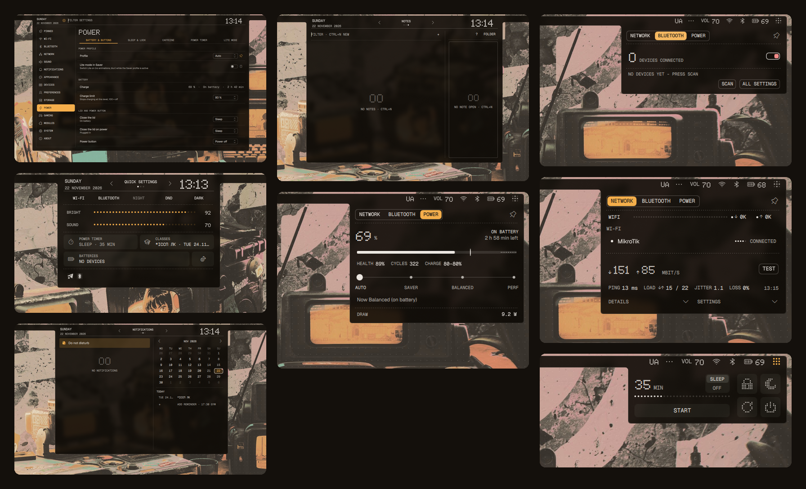

# LWTS

Lightweight Wayland Tiling Shell: a Quickshell shell for the Niri compositor (bar, launcher, quick settings, notifications, lock screen, settings app). The repo is a mirror of the live config, kept in `dotfiles/`.



## Dependencies
Arch Linux, `niri 26.04`, `quickshell 0.3.2`. The full package list is in `packages.txt`.

Required:
```
niri quickshell awww pipewire pipewire-pulse wireplumber playerctl networkmanager bluez
power-profiles-daemon upower brightnessctl wlsunset wl-clipboard wl-clip-persist grim slurp
ydotool udisks2 polkit xdg-desktop-portal-gtk xdg-desktop-portal-gnome xdg-utils libnotify
wf-recorder python python-pillow python-numpy python-gobject fontconfig glib2 dconf rsync
luajit alacritty fish nautilus adw-gtk-theme adwaita-icon-theme qt5ct qt6ct breeze
breeze-icons breeze-cursors adwaita-fonts inter-font ttf-nerd-fonts-symbols
ttf-jetbrains-mono-nerd noto-fonts noto-fonts-emoji
```

Optional, for single modules and settings pages:
```
alsa-utils exfatprogs dosfstools scx-tools smartmontools lm_sensors pacman-contrib ffmpeg jq
satty tesseract tesseract-data-eng tesseract-data-rus tesseract-data-ukr gamescope mangohud
easyeffects cups nwg-look
```

With TLP, install `tlp-pd` instead of `power-profiles-daemon`.

## Layout
`dotfiles/` mirrors `~`: the shell is `.config/quickshell/lwts`, the compositor config is `.config/niri`, helper scripts are `.local/bin`.

## Local files
Not in the repo. Create them empty on a new machine (niri fails on a missing `include`):
- `~/.config/niri/outputs.kdl`: monitors (example: `outputs.example.kdl`)
- `~/.config/niri/lwts.kdl`: generated by the shell
- `~/.config/themes/settings.toml`: personal settings
- `~/.config/lwts/sources.toml`: module catalog

## License
MIT. Third-party parts keep their own licenses: Phosphor icons (`dotfiles/.local/share/fonts/phosphor/`) and the color templates (`LICENSE-matugen-themes`).
